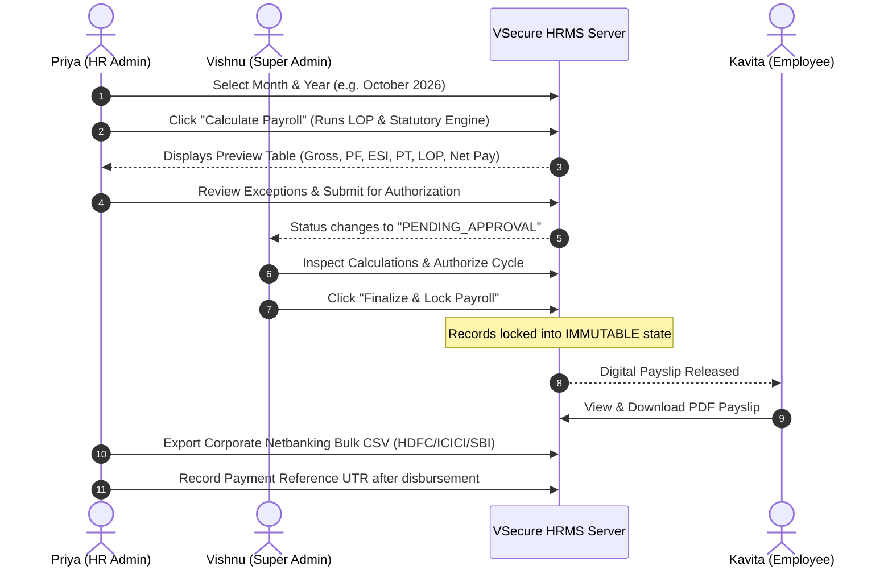

# VSecure Technologies HRMS — Enterprise Administrator Handover Guide

> **Confidential Document**  
> **System:** VSecure HRMS (Human Resource Management System)  
> **Version:** 1.0.0 (Production Launch)  
> **Primary Stakeholders:** Super Administrator Vishnu (`VS-001`), HR Operations Lead Priya Sharma (`VS-002`)  
> **Regional Standards:** Timezone: `Asia/Kolkata` (IST) | Currency: `INR (₹)` | Date Format: `DD-MM-YYYY` | Time Format: `12-hour AM/PM`  

---

## 1. Executive System Overview & Access Perimeter

VSecure HRMS is an enterprise-grade workforce management platform developed specifically for VSecure Technologies. The platform unifies employee lifecycle management, hardware-locked GPS attendance, conflict-free leave ledgers, and deterministic Indian statutory payroll across responsive web and native Android clients.

### 4-Tier Role-Based Access Hierarchy

| Role Tier | Authorized Persona | Key Capabilities | Restricted Boundaries |
| :--- | :--- | :--- | :--- |
| **Tier 1: SUPER_ADMIN** | **Vishnu (`VS-001`)** | Full system configuration, geofence radius management, payroll authorization & locked finalization, authorized payroll reopening, disaster recovery. | None. Unrestricted system authority. |
| **Tier 2: HR_ADMIN** | **Priya Sharma (`VS-002`)** | Employee onboarding, document verification, leave quota allocations, payroll preparation & preview calculation, payment reconciliation, bank upload export. | Cannot approve or finalize payroll (separation of duties). Cannot alter office geofence. |
| **Tier 3: MANAGER** | **Arjun Mehta (`VS-003`)** | Review subordinate attendance logs, approve department leave requests, field engineer tracking. | No access to company-wide salary register or peer manager compensation. |
| **Tier 4: EMPLOYEE** | **Kavita Raman (`VS-004`), Rahul Verma (`VS-005`), etc.** | GPS clock-in / clock-out within 100m geofence, apply for leave, view personal leave balance, view and download released digital payslips. | Strictly restricted to self-service records only. Anti-leakage enforced at server layer. |

---

## 2. Workforce Management & Employee Onboarding

### A. Onboarding New Employees (HR Admin Priya / Super Admin Vishnu)
1. Navigate to `/employees` &rarr; Click **"Add New Employee"**.
2. **Step 1: Personal & Identity**: Full Name, Official Email (`@vsecuretechnologies.com`), Phone Number (`+91`), Date of Birth (`DD-MM-YYYY`), Emergency Contact.
3. **Step 2: Department & Designation**: Assign Department (Engineering, HR, Operations, Sales), Designation, Office Location, and Reporting Manager.
4. **Step 3: Compensation & Statutory**:
   - Fixed Monthly Earnings: Basic Salary (INR), HRA (INR), Conveyance Allowance, Special Allowance.
   - Statutory applicability checkboxes: **PF Applicable** (12% capped at ₹1,800), **ESI Applicable** (0.75% if gross &le; ₹21,000), **Professional Tax** (₹200 standard slab).
   - Direct Deposit Bank Details: Bank Name, Account Number, and IFSC Code.
5. Click **"Save & Activate"**. An automated onboarding audit event will be logged in `PayrollAuditLog`.

### B. Account Deactivation & Compromised Credential Revocation
If an employee resigns, is terminated, or reports a lost/compromised Android phone:
1. Open `/employees/[id]` &rarr; Select **"Security & Device Binding"**.
2. Click **"Reset Device Binding"** to instantly invalidate hardware keys.
3. Toggle Employment Status from `ACTIVE` to `TERMINATED` or `INACTIVE`.
4. The server session manager immediately invalidates all active JWT tokens and mobile access.

---

## 3. GPS Attendance & Geofencing Operations

### A. Office Geofence Perimeter
- **HQ Office Coordinates**: Latitude: `12.9352`, Longitude: `77.6946` (Tech Park Campus, Outer Ring Road, Bengaluru, Karnataka 560103).
- **Allowable Radius**: Exactly **100 meters** from the building centroid.
- **Mock-Location Detection**: The mobile application inspects Android `Location.isFromMockProvider()`. If any mock location app or mock GPS flag is active, the punch is rejected immediately with a `CRITICAL` anti-spoofing alert.

### B. Shift Punctuality Rules
- **Standard Work Shift**: `09:30 AM` to `06:30 PM` (9-Hour Business Day).
- **Grace Period**: Exactly **15 minutes** (Arrival up to `09:45 AM` is marked as `PRESENT`).
- **Late Arrival**: Arrival after `09:45 AM` is logged as `LATE`.
- *Note:* Company policy does **not** automatically dock pay for late arrivals unless an authorized HR exception is flagged. Pay deduction is exclusively governed by approved Loss of Pay (LOP) days.

---

## 4. Leave Ledger & Approval Workflows

### A. Submitting & Reviewing Leaves
- **Employee Action**: Submit request via web portal (`/leave`) or mobile app (`apps/mobile/app/leave.tsx`). Select leave type (Casual, Sick, Earned, Unpaid LOP), start and end date (`DD-MM-YYYY`), full-day vs half-day session, and reason.
- **Automated Duration Engine**: Weekends (Saturday & Sunday) and recognized public holidays (Republic Day, Independence Day, Gandhi Jayanti, Diwali, Christmas) are automatically excluded from quota deductions.
- **Anti-Self-Approval Perimeter**: A Manager or Admin can **never** approve their own leave request. Subordinates are reviewed by their assigned Department Manager, with Super Admin Vishnu holding overriding authority.

### B. Leave Balance Types
- **Casual Leave (CL)**: 12 days annual quota (1.0 day/month accrual).
- **Sick Leave (SL)**: 10 days annual quota.
- **Earned Leave (EL)**: 15 days annual quota (carry forward max 10 days).
- **Loss of Pay (UNPAID_LOP)**: Approved unpaid absence subjected to daily gross deduction in Phase 5 Payroll.

---

## 5. Monthly Payroll Processing Runbook

Follow this strict step-by-step checklist between the 28th and 1st of every calendar month:

### Loss of Pay (LOP) Deduction Formula
$$\text{Daily Gross Rate} = \frac{\text{Monthly Gross Earnings}}{\text{Calendar Days in Month (e.g. 31)}}$$
$$\text{LOP Deduction} = \text{Daily Gross Rate} \times \text{Approved LOP Days}$$
$$\text{Net Salary Payable} = \text{Gross Earnings} - (\text{PF} + \text{ESI} + \text{PT} + \text{LOP Deduction} + \text{Other Deductions})$$

---

## 6. Security Incident Handling & Reopening

1. **Immutable Records**: Once a cycle reaches `FINALIZED`, ordinary edits are disabled.
2. **Authorized Reopening**: If a retroactive correction is mandated by labor audit:
   - Super Admin Vishnu clicks **"Reopen for Correction"** on `/payroll`.
   - Vishnu must enter an audit justification (minimum 8 characters).
   - An immutable event is written to `PayrollAuditLog` recording Vishnu's identity, timestamp, and justification.

---

## 7. System Health & Monitoring

- **Live Health Endpoint**: Visit `https://hrms.vsecuretechnologies.com/api/health`
- **Expected Status**: `HTTP 200 OK`
- Checks database connectivity, uptime, memory, and service status for Attendance, Leave, Payroll, and RBAC.
